## 1. Time Series and Seasonal Decomposition {#basics}

A **time series** records the same measurement in time order. Examples include a café’s daily sales, monthly restaurant spending, and electricity demand every half-hour. The **observation interval** tells us how often a reading is recorded. The **seasonal period** tells us how many readings make up one repeating cycle. Monthly readings can have an annual seasonal period of 12.

**Seasonal decomposition** estimates which part of the movement reflects the underlying level, which part repeats on a known schedule, and which part remains unexplained by those estimates.

::: {.presentation-table tabindex="0" role="region" aria-label="Scrollable table"}

| Component | Question it answers | Everyday example |
|---|---|---|
| **Trend** or **trend-cycle** | How is the underlying level moving? | A café’s sales grow gradually as it gains customers. |
| **Seasonality** | What tends to repeat at a known interval? | Sales tend to rise every Saturday. A series can have several patterns at once. |
| **Remainder** or **irregular** | What is left after the estimated components are accounted for? | A particular Saturday was unusually quiet for its time of year. |

:::

Seasonal adjustment removes the estimated seasonal contribution so periods can be compared more fairly. The adjusted series still includes irregular movement. For example, imagine a café makes $140 in sales on a Saturday. An additive decomposition explains that amount as:

::: {.presentation-table tabindex="0" role="region" aria-label="Scrollable table"}

| Component | Amount | Meaning |
|---|---:|---|
| Trend | $100 | The estimated underlying sales level at that time |
| Weekend contribution | +$30 | The extra sales usually associated with a Saturday |
| Remainder | +$10 | Sales above what the trend and usual Saturday pattern explain |
| **Actual sales** | **$140** | **$100 + $30 + $10** |

:::

**Adjusted sales are $110** because we remove the usual Saturday contribution:

**$140 − $30 = $110**

That $110 still contains the **$100 trend plus the $10 remainder**. The remainder means sales were $10 above the fitted expectation for that Saturday. More context would be needed to explain why.

This helps distinguish underlying growth from a normal busy day and gives context for unusual readings. Different methods may assign different amounts to the components. Another method might estimate: **$105 trend + $28 seasonal contribution + $7 remainder = $140**.

Both explain the same observed sales, but they estimate the pieces differently.. [Time series decomposition textbook](https://otexts.com/fpp3/decomposition.html)

## 2. What the Skill Helps People Discover {#purpose}

The skill helps people turn dated measurements into answers they can understand and check. A user can start with a spreadsheet and an everyday question. The AI turns that question into an analysis plan, runs the calculations in R, and explains the results in the units the user already knows.

::: {.presentation-table tabindex="0" role="region" aria-label="Scrollable table"}

| What someone might ask | What the skill examines |
|---|---|
| “Which months are usually busiest?” | The seasonal contribution for each month after allowing for changes in the underlying level. |
| “Are sales growing after the usual busy months are accounted for?” | The trend or seasonally adjusted series over comparable dates. |
| “How much higher is demand in winter?” | A seasonal difference in the original units or a percentage relative to a stated reference. |
| “Have the busiest hours shifted? Do weekends differ?” | Profiles for the same clock times across groups or periods, with time zone and coverage stated. |
| “Was this month unusually quiet?” | The dated remainder relative to the fitted trend and seasonal baseline. The skill checks the data before interpreting the difference. |

:::

The seven methods cover common needs at several levels of complexity. **Classical additive and multiplicative** make the distinction between a fixed amount and a fixed proportion easy to see. **STL and MSTL** allow more flexible estimates of one or several patterns. **X-11 and SEATS** provide two established approaches to calendar-based seasonal adjustment. **STR** covers cases that need a custom seasonal structure or explicitly supplied predictors.

The set covers many practical questions about historical data. Suitable timing, repeated cycles, a meaningful measurement, and adequate history still matter. A short or irregular series may support a descriptive summary while further preparation or more observations are needed for decomposition. Different methods can disagree about a changing pattern. Forecasting and causal attribution are outside this skill’s scope. An extra variable such as temperature can help describe an association when it is available and appropriately modeled.

## 3. How the AI Skill Works {#workflow}

### Accepted Files and Data Requirements {#accepted-data}

The skill analyzes a numeric measurement with a known time index. CSV and TSV files are straightforward inputs. Excel workbooks and other structured formats can be used when the available tools can read them and identify the intended table. The AI checks the contents and any required import tools before promising a fit.

::: {.presentation-table tabindex="0" role="region" aria-label="Scrollable table"}

| Input | What the skill needs | Practical example |
|---|---|---|
| **CSV, TSV, or delimited text** | A date/time column and numeric measurements, or clearly documented timing. The separator and date convention must be readable. | A shop exports `date` and `daily_sales` from its records. |
| **Excel (.xlsx or .xls)** | A readable worksheet and a clearly identified table. Import may require an Excel-reading tool or R package. The skill checks multiple sheets or candidate series with the user when needed. | A hotel supplies one worksheet of monthly bookings. |
| **Built-in or saved R data** | An accessible series or object. R `ts` and `msts` objects can carry timing metadata. A saved object must be inspectable with the available R setup. | A built-in monthly series or a user-supplied data frame. |
| **Other structured sources** | A readable table or a documented way to extract one. JSON, API responses, or database exports need conversion into ordered time and measurement columns. | A website exports dated daily visit counts as JSON. |

:::

For example, a monthly sales table could contain `2024-01-01, 12000` and `2024-02-01, 13500`, with the column names `month` and `sales_usd`. Each date labels the whole month's total. A timestamp, a number, and the meaning of that number are the essential ingredients.

**Suitable structure.** Keep each target and group identifiable, such as one series per shop. Time intervals may be hourly, half-hourly, daily, weekly, monthly, or quarterly if the chosen method supports the proposed period. Calendar months remain regularly spaced observations even though their durations differ. The skill checks the date convention, time zone, duplicates, gaps, and units, then documents preparation. A picture or a narrative needs reliable extraction into a numeric table first.

**Enough history.** Classical decomposition needs at least two full cycles. Standard STL requires more than two. The MSTL implementation used here needs more than two cycles of each intended period to retain it. X-11, SEATS, and STR require enough history for their specific settings and components. These minimums allow computation. Several well-observed repetitions give stronger evidence of a recurring pattern. Monthly data can support an annual pattern with period 12, and daily data can support a weekly pattern with period 7. One annual observation cannot reveal within-year seasonality.

**Values and preparation.** The two classical methods and standard STL need complete, finite prepared data. Classical multiplicative and logarithms require positive values. Additive approaches can accommodate zero or negative values when they make sense for the measurement. Missing values, irregular timing, and mixed groups need a justified treatment. The skill preserves the original data and records changes. Sales totals can sometimes be summed into periods, while temperature readings usually call for an average. The target and its units determine the aggregation.

### Workflow Decision Tree {#workflow-decision-tree}

::: {.workflow}
```{mermaid}
flowchart TD
    accTitle: How the Seasonal Decomposition AI Skill Works
    accDescr: Inspect the data, establish the user's question, recommend an eligible method, verify the fit in R, and deliver three report formats. If needed, prepare and recheck the data or offer a descriptive summary.
    A([Upload data]) --> B[Inspect dates, values, and seasonal history]
    B --> C{Usable time series?}
    C -->|Needs preparation| D[Explain the issue and propose a correction]
    D -.->|After correction| B
    C -->|Unsuitable| E[Explain the limit and offer a descriptive summary]
    C -->|Yes| F{Clear question supplied?}
    F -->|Yes| H{Suitable method available?}
    F -->|No| G[Offer tailored questions, a general report, or a custom request]
    G -->|User chooses a question| H
    H -->|No| E
    H -->|Yes| I[Recommend suitable methods and explain why]
    I --> J[User chooses, accepts, or delegates]
    J --> K[Fit in R and verify components and diagnostics]
    K --> L([Deliver HTML, Markdown, and Quarto])
    E -.->|If a descriptive report is requested and feasible| L

    classDef step fill:#f0f7f4,stroke:#43766d,color:#182b36;
    classDef decision fill:#dcefe8,stroke:#0b625e,color:#182b36;
    classDef user fill:#fff4d9,stroke:#947132,color:#302512;
    classDef endNode fill:#12373c,stroke:#12373c,color:#ffffff;
    class B,D,E,I,K step;
    class C,F,H decision;
    class G,J user;
    class A,L endNode;
```
:::

Questions in the workflow mark decision points, and yellow boxes show where the user guides the analysis. The skill follows a question or suitable method the user has already chosen.

::: {.presentation-table tabindex="0" role="region" aria-label="Scrollable table"}

| Stage | What the skill does | When it asks the user |
|---|---|---|
| Inspect | Identifies the numeric series, time index, frequency, and history. Checks gaps, duplicates, units, and calendar conventions. | When the target or a consequential data fix is unclear. If seasonal analysis is infeasible, it explains the issue and offers a practical correction or descriptive summary. |
| Set the question | Uses a clear question already supplied. Otherwise suggests questions suited to the upload and offers **General report** and **Type your own request**. | When the objective is open. |
| Recommend methods | Screens whether each method can handle the data, then shortlists candidates based on the question. Explains each recommendation in plain language. | The user can choose, accept the recommendation, request another eligible method, or delegate. A general report recommends one by default and uses at most three. |
| Fit and verify | Runs the selected analysis in R. Checks the dates, whether components recombine to the appropriate input, remaining patterns, and software warnings. | When a failed fit requires a different method or a consequential change in preparation. |
| Report | Gives a direct answer with a dataset introduction, method rationale, original and fitted figures as appropriate, explanations below each plot, a worked calculation, limitations, and references. | The user can open any of the three report files. |

:::

**Reading and reuse.** `report.html` is the styled report to open in a browser. `report.md` contains the same report in Markdown, and `report.qmd` is the editable source for rendering with Quarto. A completed analysis also saves the R code, aligned component values, settings, and checks. `SKILL.md` contains the main workflow. The checklist, decision tree, methods reference, and report specification give the AI the details it needs at each stage. [Skill repository](https://github.com/albertbryantk/seasonal-decomposition)

## 4. The Seven Methods {#methods}

In the formulas, $t$ is an observation’s time index, $y_t$ is the observed value, $T_t$ is the trend, $S_t$ is a seasonal effect or factor, $R_t$ is the remainder, and $m$ is the number of observations in one seasonal cycle. Hats indicate fitted estimates. The examples in this section use small illustrative numbers. Section 5 uses fitted values from the Great Britain electricity demand analysis.

### Classical Additive {#additive}

**Idea.** A fixed seasonal effect adds or subtracts roughly the same amount each cycle. For monthly sales, May receives one fixed dollar effect across years. For daily café sales with a weekly cycle, Saturday might add $30 to the trend every week, while Monday might subtract $15. Each weekday has its own fixed seasonal effect, even as the café’s underlying sales level changes.

$$y_t=T_t+S_t+R_t,\qquad R_t=y_t-T_t-S_t.$$

Estimate $T_t$ with a centered moving average, a weighted average of surrounding observations. Group $y_t-\hat T_t$ by seasonal position, such as all Mays, average within each group, then center the $m$ seasonal averages to sum to zero. Repeat that pattern. Adjusted observations are $y_t-\hat S_t$.

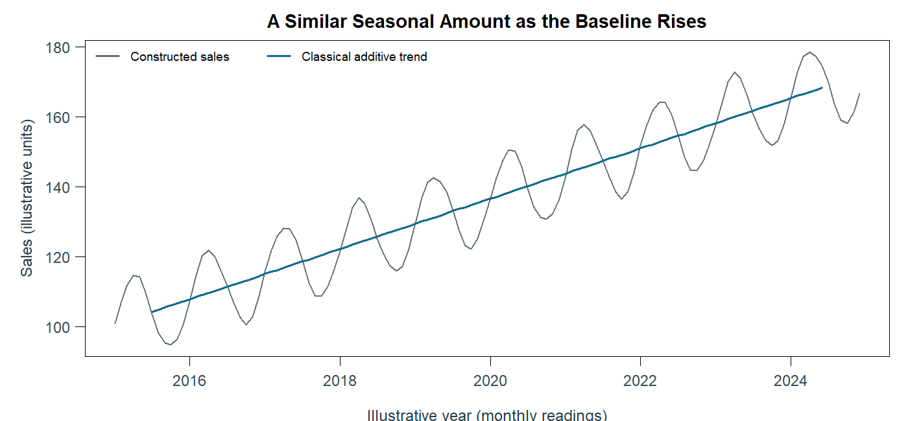

**How to Read This Graph.** This constructed monthly series has an upward baseline and a seasonal amount with constant amplitude. Gray shows the constructed sales, and blue shows the fitted classical trend. The horizontal axis covers illustrative years 2015–2024 and the vertical axis uses invented sales units. The swings above and below the trend stay about the same size as the level rises. The trend ends early because the centered moving average needs observations on both sides. The arithmetic example below uses separate small numbers.

**Example.** Imagine a café’s weekly pattern includes:

- **Saturday:** +$30 above the trend.
- **Sunday:** +$20 above the trend.
- **Monday:** −$15 below the trend.

Those effects repeat each week. As the café’s underlying sales grow, Saturday still contributes **+$30**:

::: {.presentation-table tabindex="0" role="region" aria-label="Scrollable table"}

| Week | Trend Level | Saturday Effect | Expected Saturday Sales Before the Remainder |
|---|---:|---:|---:|
| 1 | $100 | +$30 | $130 |
| 2 | $120 | +$30 | $150 |
| 3 | $150 | +$30 | $180 |

:::

“Fixed” means **Saturday receives the same estimated effect every week**. Different days can have different effects. The other days in a complete seven-day additive pattern are estimated too, with all seven effects centered to sum to zero.

Actual Saturday sales can still vary because the remainder captures deviations from the fitted expectation. For example, a $150 trend, a +$30 Saturday effect, and a −$5 remainder produce **$175 observed sales**.

These numbers illustrate a stable seasonal pattern in dollars. Classical additive repeats the fitted effects exactly. The centered trend and remainder are unavailable near both ends. [R classical decomposition](https://stat.ethz.ch/R-manual/R-devel/library/stats/html/decompose.html)

**Strengths.** Easy to explain in the original units. It provides a simple benchmark when the seasonal increase or decrease stays roughly constant.

**Limitations.** It repeats one fixed seasonal pattern, so changing seasonal size or shape can be left in the remainder. Centered moving averages leave the trend and remainder unavailable near both ends.

### Classical Multiplicative {#multiplicative}

**Idea.** A fixed proportion changes the value. The seasonal percentage stays the same for a given seasonal position, while its effect in the original units grows with the trend level. A 10% boost adds $10 when the baseline is $100 and $20 when it is $200.

$$y_t=T_t S_t R_t,\qquad R_t=\frac{y_t}{T_t S_t}.$$

Use the classical moving-average trend, group the ratios $y_t/\hat T_t$ by seasonal position, and normalize the average factors to have mean one. Adjusted observations are $y_t/\hat S_t$. The factor $S_t$ represents a seasonal percentage of $100(S_t-1)$ relative to trend. This implementation requires strictly positive values and has the same endpoint gaps as classical additive.

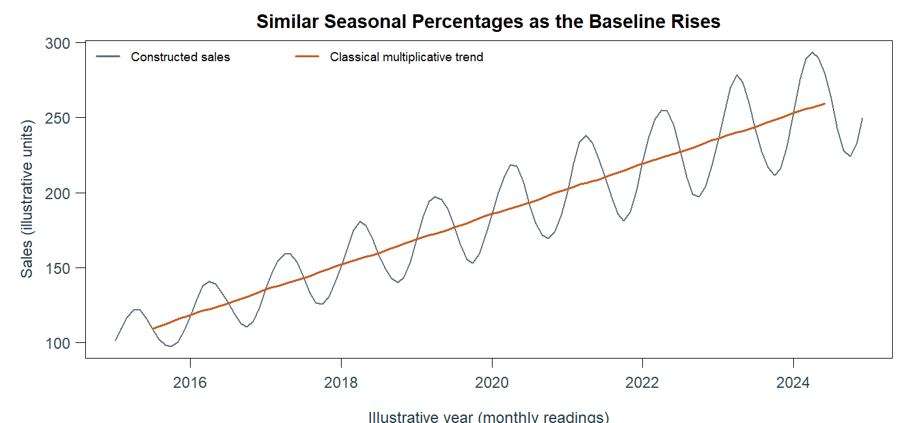

**How to Read This Graph.** Gray shows constructed monthly sales and orange the fitted classical trend. The horizontal axis covers illustrative years 2015–2024 and the vertical axis uses invented sales units. The pattern was constructed with a seasonal multiplier varying by about 15% around one. Its dollar-sized swings expand as the baseline rises. This makes a fixed seasonal ratio a sensible description. The trend has the same centered-average endpoint gaps. The arithmetic below uses separate small numbers.

**Example.** Imagine the same café’s weekly pattern is described by percentages:

- **Saturday:** 30% above the trend, a seasonal factor of **1.30**.
- **Sunday:** 20% above the trend, a seasonal factor of **1.20**.
- **Monday:** 15% below the trend, a seasonal factor of **0.85**.

Those percentages repeat each week. As the café’s underlying sales grow, Saturday still contributes **30%**, while the dollar amount of that contribution grows:

::: {.presentation-table tabindex="0" role="region" aria-label="Scrollable table"}

| Week | Trend Level | Saturday Effect | Seasonal Increase | Expected Saturday Sales Before the Remainder |
|---|---:|---:|---:|---:|
| 1 | $100 | +30% (×1.30) | +$30 | $130 |
| 2 | $120 | +30% (×1.30) | +$36 | $156 |
| 3 | $150 | +30% (×1.30) | +$45 | $195 |

:::

“Fixed” means **Saturday receives the same estimated percentage effect every week**. Different weekdays can have different factors. All seven weekday factors in a complete fitted pattern are normalized to have mean one.

Actual Saturday sales can still vary because the remainder is another multiplier. For example, a **$150 trend**, a **1.30 Saturday factor**, and a **0.95 remainder factor** produce **$185.25 observed sales**: **$150 × 1.30 × 0.95 = $185.25**

The seasonal baseline is $195. A remainder factor of 0.95 means observed sales are **5% below that baseline**. Adjusted sales remove the seasonal factor by division: **$185.25 ÷ 1.30 = $142.50**. That equals the trend multiplied by the remainder factor, $150 × 0.95.

These illustrative factors describe seasonal effects in proportion to the trend. Classical multiplicative requires positive values and has the same centered-average endpoint gaps as classical additive. [R classical decomposition](https://stat.ethz.ch/R-manual/R-devel/library/stats/html/decompose.html)

**Strengths.** Expresses recurring effects as percentages, making it easy to interpret a pattern whose dollar-sized swings grow with the underlying level.

**Limitations.** It requires strictly positive values and repeats fixed seasonal factors. A changing percentage pattern may be poorly represented, and centered moving averages leave endpoint gaps.

### STL {#stl}

**Idea.** Seasonal-Trend Decomposition Using **LOESS** (locally weighted regression) smooths nearby observations. It can let one seasonal pattern evolve, for example when the typical May effect gradually increases.

$$y_t=T_t+S_t+R_t.$$

STL alternates between smoothing detrended observations at the same seasonal position and smoothing deseasonalized observations across time. A low-pass smoother helps separate slow drift from seasonality. Seasonal and trend windows set how much information the smoothers use. Robust fitting gives unusually large deviations less influence. The identity is additive on the fitting scale. With a log transformation of positive values, exponentiation yields factors on the original scale.

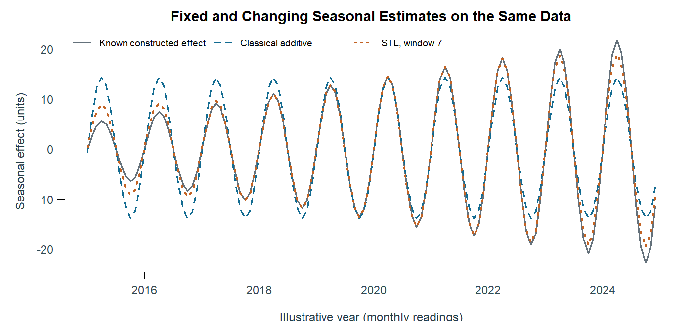

**How to Read This Graph.** All curves refer to the same constructed monthly series over illustrative years 2015–2024. The vertical axis is the seasonal contribution in invented units, with a dotted gray zero reference. The solid gray curve is the known seasonal effect used to construct the data. Its amplitude grows over time. Dashed blue is the fixed pattern estimated by classical additive. Dotted orange is the seasonal component fitted by STL with seasonal window 7. STL follows more of the gradual change. This comparison shows a difference in what the methods can represent on deliberately changing data. On stable seasonal data the two methods may agree much more closely.

**Example.** Imagine the same café’s Saturday boost gradually grows as customers’ habits change. A changing-season STL fit can estimate a different Saturday effect at different times:

::: {.presentation-table tabindex="0" role="region" aria-label="Scrollable table"}

| Period | Trend Level | Estimated Saturday Effect | Expected Saturday Sales Before the Remainder |
|---|---:|---:|---:|
| Earlier in the history | $100 | +$20 | $120 |
| Middle of the history | $120 | +$30 | $150 |
| Later in the history | $150 | +$40 | $190 |

:::

These illustrative snapshots summarize a longer daily series with many observed weeks. STL smooths information across neighboring weeks to estimate how each weekday’s effect evolves. Sunday and Monday can also have their own changing effects. In this example, the Saturday increase grows by a changing amount in dollars. Classical additive would estimate one fixed Saturday amount, while classical multiplicative would estimate one fixed Saturday percentage.

Actual sales can still differ from the seasonal baseline. At the later date, a **$150 trend**, a **+$40 Saturday effect**, and a **−$5 remainder** produce **$185 observed sales**: **$150 + $40 − $5 = $185**. Adjusted sales remove the estimated Saturday effect: **$185 − $40 = $145**. That leaves the $150 trend plus the −$5 remainder.

**What Does Seasonal Window 7 Mean?** In R’s STL, `s.window = 7` controls how much nearby information is used to smooth each seasonal position across cycles. For daily café sales with a weekly cycle, it smooths the detrended Saturday readings across a neighborhood of seven Saturdays, and does the same separately for each other weekday. Where enough observations are available, that neighborhood can include the current Saturday and three Saturdays on either side.

For monthly sales with an annual cycle, the corresponding neighborhood is seven occurrences of the same month, such as seven Mays across years. In the teaching graph above, the data are monthly, so the window is applied across years. The **seasonal period** sets the length of a repeating cycle, such as seven days or twelve months. The **seasonal window** sets how much smoothing is applied across repeated occurrences of each position.

A larger seasonal window usually produces a more stable, slowly changing seasonal pattern. A smaller permitted window allows more local change. R recommends an odd numeric window of at least 7. Setting `s.window = "periodic"` fits a fixed seasonal pattern. Available history and boundary handling still affect the estimates, so a window setting alone does not guarantee that seasonal change can be estimated reliably. [R STL documentation](https://search.r-project.org/R/refmans/stats/html/stl.html)

**Strengths.** Allows a seasonal pattern to change gradually and offers robust fitting to reduce the influence of unusual observations. Components remain easy to interpret on the fitting scale.

**Limitations.** Standard STL handles one seasonal period. The smoothing windows affect the result, and holiday or temperature effects need separate modeling. Standard R STL also requires complete input.

### MSTL {#mstl}

**Idea.** Multiple Seasonal-Trend Decomposition Using LOESS extends STL to several seasonal periods. In hourly data, use 24 for a day and 168 for a week when both patterns are supported.

$$y_t=T_t+\sum_{j=1}^{k}S_{j,t}+R_t.$$

Here $k$ is the number of cycles modeled and $S_{j,t}$ is the contribution of cycle $j$. MSTL cycles through the selected periods, applying STL after allowing for the other current seasonal estimates, and refining the components. The R implementation must retain all requested periods. Related periods, such as day and week, are interpreted jointly.

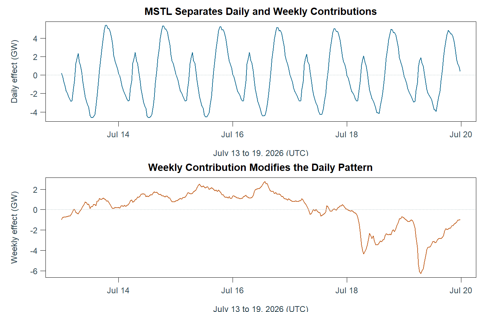

**How to Read This Graph.** These are existing fitted MSTL components from July 13–19, 2026 in the electricity report. Both horizontal axes show elapsed time in UTC. Blue in the top panel is the daily contribution in GW, and orange below is the weekly contribution in GW. Each panel has its own vertical range. Dotted zero lines mean no contribution. The daily shape repeats seven times while the weekly curve modifies different parts of the week. Add both contributions to trend to obtain the fitted level.

**Example.** The July 13–19 electricity graph shows two recurring contributions estimated from Great Britain’s half-hourly National Demand readings. This week is an illustration of a fit to all **14,784 readings from January 1 to November 4, 2026**. The model uses the full available history to help estimate the patterns shown during that week.

**Step 1 — Define the Repeating Cycles.** One reading represents half an hour, so **48 readings make a day** and **336 readings make a week**. MSTL was given both periods on a regular UTC timeline. In the teaching graph, blue shows the daily contribution and orange the weekly contribution. Their vertical axes are in gigawatts (GW), where **1 GW = 1,000 megawatts (MW)**. Zero means no contribution at that time. The original report’s four-panel July graph also shows the trend, observed and fitted demand, and remainder.

**Step 2 — Estimate the Components Together.** MSTL repeatedly applies STL to estimate one seasonal component while allowing for the current estimate of the other. It refines the daily and weekly patterns, estimates the smoothed trend, and calculates what remains. The daily component captures the recurring within-day shape. The weekly component adds differences associated with a position in the week, such as the weekend morning dips. These components are estimated jointly and should be read together. Each daily peak or weekend dip is estimated from repeated observations across the history.

This fit used **seasonal windows 11 and 15**, for the daily and weekly cycles respectively. They control smoothing across repeated positions in those cycles, such as the same half-hour across days or across weeks. They are separate from the periods of 48 and 336. Robust fitting reduced the influence of unusually large deviations, and the data were fitted on the original MW scale. [R MSTL documentation](https://pkg.robjhyndman.com/forecast/reference/mstl.html)

**Step 3 — Add the Fitted Contributions at One Actual Half-Hour.** At **7:30 p.m. British Summer Time on July 15, 2026**, which is **6:30 p.m. UTC**, the saved fitted values were:

::: {.presentation-table tabindex="0" role="region" aria-label="Scrollable table"}

| Quantity | Value (MW) | Meaning at This Half-Hour |
|---|---:|---|
| Trend | 21,625.73 | The smoothed underlying demand level. |
| Daily contribution | +5,238.97 | The contribution of the daily cycle at this half-hour. |
| Weekly contribution | +1,773.97 | The additional contribution of the weekly cycle at this position in the week. |
| **Fitted demand** | **28,638.66** | **Trend + daily contribution + weekly contribution**, using unrounded values. |
| Remainder | +66.34 | The difference between observed and fitted demand. |
| **Observed demand** | **28,705.00** | **The actual reading**, equal to fitted demand + remainder. |

:::

**Fitted demand ≈ 21,625.73 + 5,238.97 + 1,773.97 ≈ 28,638.66 MW**
**Remainder = 28,705.00 − 28,638.66 ≈ 66.34 MW**

**Step 4 — Remove Both Seasonal Contributions if Needed.** Adjusted demand is observed demand minus the daily and weekly effects: **28,705.00 − 5,238.97 − 1,773.97 ≈ 21,692.07 MW**, using unrounded components. It contains the **21,625.73 MW trend plus the 66.34 MW remainder**.

The blue and orange teaching curves show two of the contributions used in this calculation at every half-hour. The daily curve supplies the repeated rise and fall, and the weekly curve modifies it across the week. Adding them to the trend gives the fitted demand. The remainder measures the difference from the actual observation.

**Strengths.** Separates several recurring patterns on the same timeline, such as daily and weekly effects, making it useful for hourly or half-hourly data.

**Limitations.** Each selected cycle needs enough observed repetitions. Related cycles can share similar features, so the components must be interpreted together. Results depend on the chosen periods and smoothing settings. [MSTL documentation](https://pkg.robjhyndman.com/forecast/reference/mstl.html)

### X-11 {#x11}

**Idea.** X-11 uses several passes of moving averages to separate the trend-cycle and seasonal factors. The skill runs it through X-13ARIMA-SEATS for monthly or quarterly adjustment. X-13 can also account for specified calendar effects before the filtering stages.

$$M_t=\sum_{i=-h}^{h}w_i z_{t+i},\qquad \sum_i w_i=1.$$

This is the form of a centered moving-average filter. $z$ is the series entering that pass, $i$ is a position relative to $t$, $h$ is the half-width of the window, and $w_i$ is a filter weight. X-11 alternates trend and seasonal smoothing with different filters and uses special handling near the ends. In a multiplicative run without separate effects, its component identity is $y_t=T_t S_t R_t$. With separate calendar factors, use the reported combined adjustment factor and table definitions.

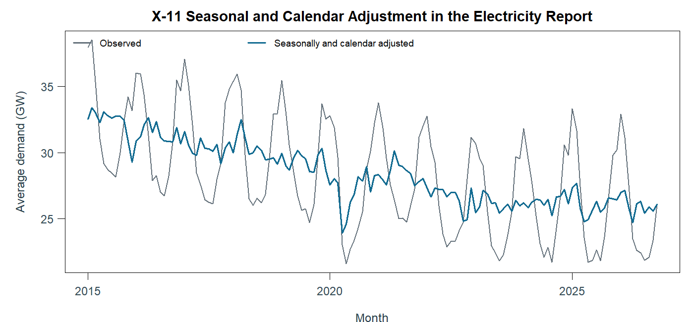

**How to Read This Graph.** This graph reuses the fitted monthly electricity example. The horizontal axis runs from January 2015 to October 2026 and the vertical axis is average demand in GW. The gray line shows observed demand, with its large winter rises and summer fall. Blue is the X-11 series after the estimated seasonal and calendar effects have been removed. The blue curve has a smaller recurring winter–summer rise and fall while retaining other movements. Seasonally adjusted values still contain irregular movement.

**Example.** In **January 2026**, Great Britain’s observed National Demand averaged **32.88741 GW** across the month’s half-hour readings. The dataset labels this monthly observation `2026-01-01`, which represents the whole month of January. X-11 was fitted using the longer monthly history from January 2015 through October 2026 to estimate the recurring pattern around this date.

For January 2026, the estimated **seasonal factor was 1.219288**, representing the recurring January effect. The separately modeled **calendar factor was 0.999574**, accounting for the share of weekdays in that month. Multiplying them gives the **combined adjustment factor of 1.218769**, using unrounded values. A factor of one would mean no adjustment. Here, the combined factor places observed demand about **21.88% above its adjusted value**.

To remove those seasonal and calendar effects, divide the observed value by the combined factor: **Adjusted demand = 32.88741 ÷ 1.218769 ≈ 26.98412 GW**. The difference is about **5.90329 GW**. This is the contribution associated with the combined adjustment at this date and level.

The adjusted value still contains the trend and irregular movement. In this fit, the **trend was 26.67665 GW** and the **irregular factor was 1.011526**. Their product gives approximately **26.98412 GW**, so adjusted demand was about **1.15% above the estimated trend**. The gray curve in the teaching graph shows the observed monthly series, while the blue curve shows the adjusted values, including this January result. [X-13 manual](https://www2.census.gov/software/x-13arima-seats/x13as/unix-linux/documentation/docx13ashtml.pdf)

**Strengths.** Provides an established filter-based approach to monthly or quarterly seasonal adjustment. Through X-13, the analysis can incorporate specified calendar and outlier adjustments.

**Limitations.** It needs sufficient calendar-aligned history and a working X-13 setup. Recent estimates can revise when new data arrive, and adjustment settings can change the interpretation. It is suited to the monthly or quarterly workflow used in this skill.

### SEATS {#seats}

**Idea.** Signal Extraction in ARIMA Time Series estimates the pieces from a fitted **ARIMA** model. ARIMA stands for autoregressive integrated moving average. It describes how a series depends on earlier values, differencing, and current or previous random shocks.

$$z_t=T_t+S_t+I_t,\qquad \hat S_t=\sum_j a_j z_{t-j}.$$

This illustrates the common trend–seasonal–irregular case on the modeled scale. $z_t$ is the prepared, possibly transformed series, $I_t$ is its irregular component, and the weights $a_j$ for seasonal extraction are derived from the fitted model and its implied component behavior. The filter can use information on both sides of a date. In X-13, check the fitted model and any separate or additional components before using the output identities.

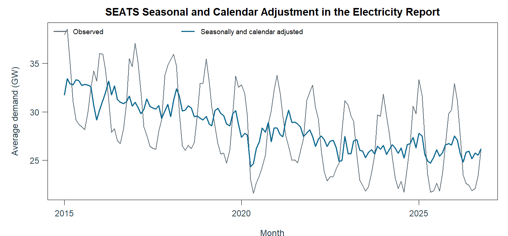

**How to Read This Graph.** This graph uses the same observed monthly electricity series and preprocessing as the X-11 teaching graph. The horizontal axis covers January 2015–October 2026, and the vertical axis shows GW. Gray is observed demand and blue is the SEATS seasonal-and-calendar-adjusted series. The smoother annual profile shows the effect of removing the model-estimated recurring factors. The observed and adjusted curves alone cannot establish whether SEATS or X-11 is preferable. Their diagnostics and the question also matter. The example below uses the actual January 2026 fitted values.

**Example.** In **January 2026**, Great Britain’s observed National Demand averaged **32.88741 GW** across the month’s half-hour readings. The monthly label `2026-01-01` represents the whole month of January. SEATS used the same January 2015–October 2026 monthly history and calendar variable as the X-11 comparison. It derived its component filters from the fitted seasonal ARIMA model.

For January 2026, the **SEATS seasonal factor was 1.196328**. This represents a recurring January contribution of about **+19.63%** relative to the level with the pure seasonal effect removed. The **calendar factor was 0.999574**, representing the modeled effect of that month’s weekday share. Multiplying the seasonal and calendar factors gives the **combined factor of 1.195818**, about **19.58% above its adjusted value**.

To remove those seasonal and calendar effects, divide observed demand by the combined factor: **Adjusted demand = 32.88741 ÷ 1.195818 ≈ 27.50201 GW**. The difference is about **5.38539 GW**, using unrounded values. This is the contribution associated with the combined adjustment at this date and level. Multiplying back checks the calculation: **27.50201 × 1.195818 ≈ 32.88741 GW**.

The adjusted value still contains trend and irregular movement. SEATS estimated a **27.07226 GW trend** and an **irregular factor of 1.015874**. Their product gives approximately **27.50201 GW**, meaning the adjusted reading was about **1.59% above trend**. The graph’s gray curve contains the observed January reading, while its blue curve contains the adjusted January value.

SEATS estimates a seasonal factor at each monthly date. Factors can differ between January and July and can evolve between successive Januaries, depending on the fitted model and data. For this January, SEATS and X-11 start from the same observed value but produce different seasonal factors and adjusted values because their component-extraction procedures differ. [X-13 manual](https://www2.census.gov/software/x-13arima-seats/x13as/unix-linux/documentation/docx13ashtml.pdf)

**Strengths.** Connects the trend and seasonal estimates to a fitted ARIMA model, providing a model-based way to separate the components and examine model diagnostics.

**Limitations.** Its results depend on the suitability of the fitted ARIMA model and whether that model permits a valid component decomposition. The model needs adequate history and diagnostic checks, and endpoint estimates can revise.

### STR {#str}

**Idea.** Seasonal-Trend Decomposition Using Regression fits a trend, seasonal effects, and any specified predictors together. It can represent distinct calendar patterns and non-integer periods on a suitable regular time grid.

$$y_t=T_t+\sum_{j=1}^{k}S_{j,t}+x_t^\mathsf{T}\beta+R_t.$$

In this simplified example $x_t$ is a vector of extra measurements or indicators and $\beta$ gives their coefficients. The superscript $\mathsf{T}$ transposes the vector so $x_t^\mathsf{T}\beta$ is a sum of contributions. Without extra predictors the regression contribution is omitted. Standard STR minimizes a criterion of this form:

$$\sum_t R_t^2+\lambda_T P(T)+\sum_{j=1}^{k}\lambda_j P_j(S_j).$$

The first term measures how closely the components fit the observations. The functions $P$ and $P_j$ penalize roughness in the trend and seasonal components, and the weights $\lambda$ control how strongly the estimates are smoothed.

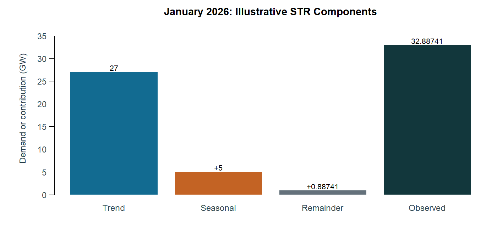

**How to Read This Graph.** The horizontal categories name the components and the observation, and the vertical axis is GW. Blue shows an illustrative 27 GW trend, orange a +5 GW seasonal contribution, gray a +0.88741 GW remainder, and dark teal the actual January 2026 monthly average of 32.88741 GW. Adding the first three bars gives the final bar. The component values are hypothetical teaching values chosen to explain the arithmetic. The observed total comes from the electricity report. An STR fit of that electricity series would be needed to estimate its actual components.

**Example.** Consider the **same January 2026 electricity observation** used for X-11 and SEATS. Great Britain’s observed monthly National Demand averaged **32.88741 GW**. The date label `2026-01-01` refers to the whole month. To understand STR’s additive calculation, suppose it estimated a **27 GW trend** and a **+5 GW January seasonal contribution**. These two component values are illustrative. They show how the calculation works without claiming an STR result from the electricity report.

::: {.presentation-table tabindex="0" role="region" aria-label="Scrollable table"}

| Quantity | Value (GW) | Meaning |
|---|---:|---|
| Trend | 27.00000 | The illustrative underlying demand level for January. |
| January seasonal contribution | +5.00000 | The illustrative amount added by the recurring annual pattern. |
| **Fitted demand** | **32.00000** | **27 + 5**, the expected value before the remainder. |
| Remainder | +0.88741 | The difference between observed demand and that illustrative fit. |
| **Observed demand** | **32.88741** | The actual January 2026 monthly average from the electricity data. |

:::

**How STR Would Estimate the Components.** STR fits the trend and seasonal pattern together across the available history. It balances closeness to the observations against smoothness penalties, which discourage abrupt changes in the fitted components. Its January contribution can evolve over time when the specification allows it. This example includes one annual seasonal component. Additional temperature or calendar contributions can be included when they are explicitly specified and supported by the data. [STR paper](https://arxiv.org/abs/2009.05894) · [R STR documentation](https://pkg.robjhyndman.com/stR/reference/STR.html)

**Strengths.** Can combine flexible or multiple seasonal structures with explicitly specified predictors, such as temperature or holiday indicators. It can also represent non-integer seasonal periods.

**Limitations.** A flexible specification takes more care to set up and interpret. Predictors must align with the observations, and the history must distinguish their effects from trend and seasonality. Smoothing choices influence the estimated contributions. [STR documentation](https://pkg.robjhyndman.com/stR/reference/STR.html)

### Mapping the Question to a Method {#method-map}

The skill checks feasibility first, then ranks candidates by which ones address the question with a suitable level of complexity. One series can qualify for several rows. The user selects a plan or delegates that choice after seeing the reasons.

::: {.presentation-table tabindex="0" role="region" aria-label="Scrollable table"}

| Evidence and Goal | Candidate | Practical Scenario Question | Check Before Using It |
|---|---|---|---|
| One stable cycle, similar swings in dollars, counts, or other units | **Classical additive** | “How many extra orders does my café usually receive on Saturdays?” | Regular grid, enough repeated cycles, and acceptable endpoint gaps. |
| One stable cycle, swings proportional to the underlying level | **Classical multiplicative** | “Which months usually add the largest percentage to shop sales?” | Positive series and meaningful ratios. |
| One cycle, flexible trend or a seasonal shape that may change | **STL** | “Has the usual summer increase in ice-cream sales become larger?” | Enough repeats to support change. Use robust fitting when appropriate. |
| More than one recurring period on the same grid | **MSTL** | “What are the busiest hours for my website, and how do weekends differ?” | Sufficient coverage of each period. Retain each cycle and interpret overlapping periods together. |
| Filter-based monthly or quarterly seasonal adjustment | **X-11** | “After allowing for season and calendar mix, is monthly demand falling?” | Calendar alignment, sufficient history, and documented adjustment settings. |
| Model-based adjustment at a supported calendar frequency | **SEATS** | “What underlying and seasonal components does a fitted monthly demand model imply?” | A suitable decomposable ARIMA model and acceptable diagnostics. |
| Custom seasonal structure, fractional periods, or extra variables | **STR** | “How do recurring demand patterns look when recorded temperature and holidays are included?” | Adequate history to distinguish the effects and correctly aligned inputs. |

:::

When the user asks which periods stand out, report seasonal effects by calendar phase. When they ask whether a pattern changed, compare the same phase across spans with a method that can represent change. For unusually high or low readings, show the observation’s date and deviation from its fitted baseline. Method choice follows the result the user needs to interpret.

## 5. Example from the Skill {#examples}

### Great Britain Electricity Demand {#electricity}

**Questions.** How large is the winter increase? Has it changed over time? When does demand usually peak, and how do weekdays and weekends differ?

**Data.** The National Energy System Operator (NESO) records National Demand (`ND`) in megawatts (MW) for each half-hour settlement interval. National Demand is a defined measure of metered generation that excludes station load, hydro storage pumping, and interconnector exports. One gigawatt (GW) equals 1,000 MW. These are power readings. The monthly analysis uses average power across the half-hours within a month. [NESO archive](https://www.neso.energy/data-portal/historic-demand-data) · [2026 data and definitions](https://www.neso.energy/data-portal/historic-demand-data/historic_demand_data_2026)

::: {.presentation-table tabindex="0" role="region" aria-label="Scrollable table"}

| Question | Analysis series | Method choice |
|---|---|---|
| Winter versus summer across years | 142 complete calendar months, January 2015–October 2026, from the 2015–2025 annual files and the 2026 upload. The first four days of November 2026 form a partial month and were excluded here. | **X-11** and **SEATS** compare filter-based and ARIMA-based adjustment using the same annual period of 12 months. |
| Daily peaks and weekday–weekend differences | All 14,784 actual half-hours from January 1 to November 4, 2026. The time grid was checked for missing, duplicate, and invalid values, including the 46-interval spring day and 50-interval autumn day on the UK clock. | **MSTL** separates daily and weekly patterns at 48 and 336 elapsed half-hours. The fit used regular UTC (Coordinated Universal Time) and the display uses UK local time. |

:::

**Why These Methods.** X-11 and SEATS were chosen to compare two ways of estimating the annual pattern in monthly demand. Both used log-transformed data and accounted for each month’s weekday mix. MSTL was chosen for the half-hour readings because it separates daily and weekly patterns together. Robust smoothing reduced the influence of unusual readings. Classical decomposition and STL could provide simpler monthly comparisons. STR could be used if the analysis also needed temperature or holiday variables.

**Model Detail.** Both monthly analyses used the same seasonal ARIMA model, comparing each month with the same month a year earlier and describes how those year-on-year changes relate to the previous month’s changes. It also accounts for unexpected movements twelve months apart. X-11 and SEATS then use different procedures to extract the components. SEATS kept this selected model without switching to an alternative. [X-13 manual](https://www2.census.gov/software/x-13arima-seats/x13as/unix-linux/documentation/docx13ashtml.pdf)

#### Figure 1. Monthly Demand and Underlying Trend

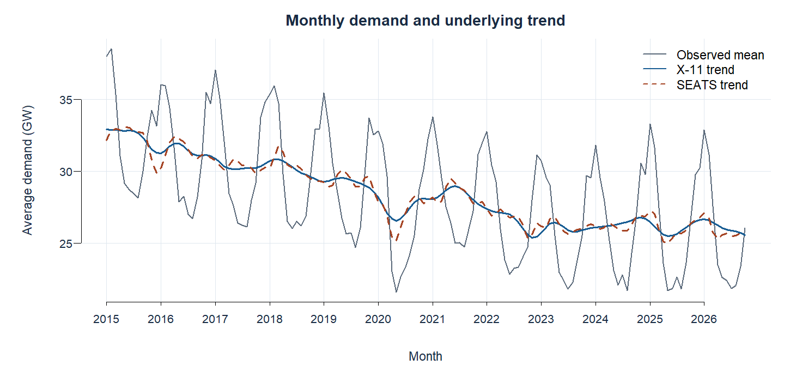

**Axes and lines.** The horizontal axis shows calendar months with January year labels and pale vertical guides. The vertical axis shows average power demand in GW. Pale horizontal lines match the power ticks. Solid gray is the observed monthly mean. Solid blue is the X-11 trend estimated with filters. Dashed orange is the SEATS trend derived from the fitted ARIMA model.

The gray line has a recurring winter rise and summer fall. The two smooth lines show the longer decline. The average X-11 trend was **32.5 GW in 2015** and **26.0 GW in 2025**. Those values average the estimated trend across each year. Both smooth curves tell a similar broad story.

#### Figure 2. Winter–Summer Gap by Year

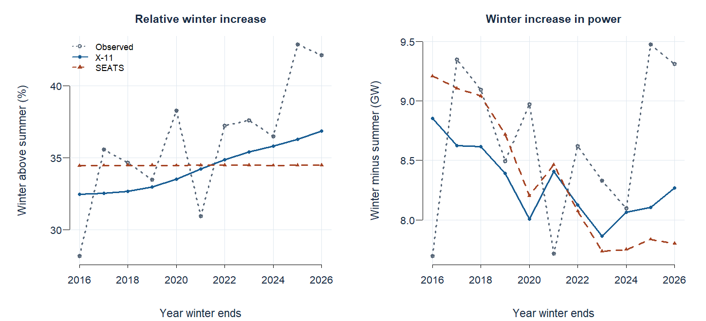

**Axes and marks.** Both horizontal axes show the year winter ends, from 2016 to 2026. Winter is December–February, so winter 2026 begins in December 2025. Summer is June–August of the ending year. The left vertical axis is the percentage increase relative to summer. The right vertical axis is the difference in GW. Pale guides mark the ticks. Dotted gray with open circles is observed, solid blue with filled circles is X-11, and dashed orange with triangles is SEATS.

**How the numbers are calculated.** Averages give each half-hour equal weight by weighting months by their number of readings. For the observed comparison, winter averaged **31.43 GW** and summer **22.12 GW** in 2026. Subtraction gives **9.31 GW**. Dividing the difference by summer demand gives **42.1%**, using unrounded values. For each fitted comparison, divide the winter seasonal factor by the summer factor, subtract one and multiply by 100 for percent. For GW, multiply the difference of the factors by the fitted trend averaged across those six months. This puts winter and summer on the same underlying power level within each comparison.

::: {.presentation-table tabindex="0" role="region" aria-label="Scrollable table"}

| Winter-ending year(s) | Observed GW | Observed % | X-11 GW | X-11 % | SEATS GW | SEATS % |
|---|---:|---:|---:|---:|---:|---:|
| 2016–2018 average | 8.71 | 32.8% | 8.70 | 32.6% | 9.12 | 34.5% |
| 2024–2026 average | 8.96 | 40.5% | 8.15 | 36.3% | 7.80 | 34.5% |
| 2026 | 9.31 | 42.1% | 8.27 | 36.9% | 7.80 | 34.5% |

:::

Both methods find a substantial winter increase. In 2026 the estimated recurring increase is **7.80–8.27 GW**, or **34.5%–36.9%**. The change over time depends on the method. X-11’s early-to-late increase is about **3.8 percentage points** using the unrounded averages. SEATS stays near 34.5%. Percentage points measure subtraction of two percentages. A shrinking baseline can make a larger percentage correspond to fewer GW, as the X-11 group averages show.

#### Figure 3. One July Week of the Half-Hour Decomposition

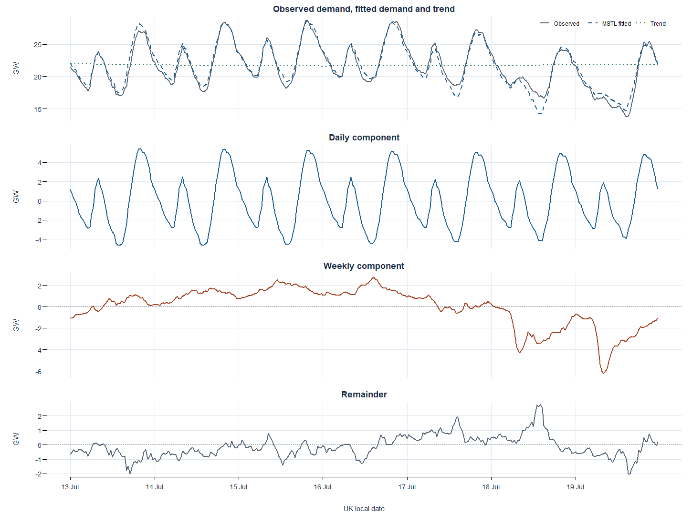

**Axes and lines.** All panels use the UK local dates July 13–19, 2026. Vertical guides mark local midnight. Horizontal guides mark the GW ticks, and each panel has its own vertical range. From top to bottom:

1. **Observed, fitted, trend.** Solid gray is the observed demand. Dashed blue is the fitted demand, trend plus the daily and weekly contributions. Dotted green is the trend alone.
2. **Daily effect.** Solid blue shows the contribution of the 48-half-hour component. Its rise and fall repeats through the week.
3. **Weekly effect.** Solid orange shows the 336-half-hour component, which modifies the daily pattern across days of the week. The effects dip on Saturday and Sunday mornings.
4. **Remainder.** Solid gray shows observed minus fitted demand. Positive values are readings above the fitted line. Negative values are readings below it.

The lower panels explain what was added to the trend and what was left over. The dotted gray zero lines in panels 2–4 mark no contribution or difference. This week illustrates the fit computed using the entire 2026 upload.

#### Figure 4. Fitted Weekday and Weekend Profiles

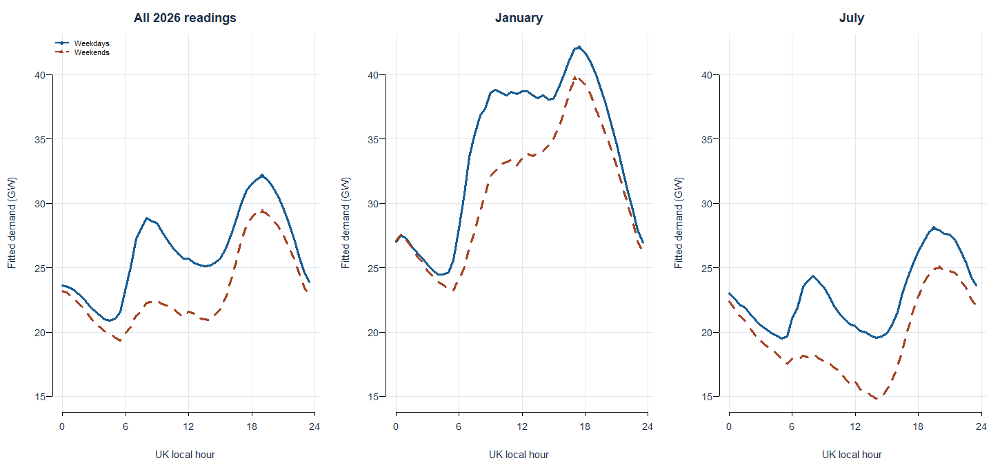

**Axes and marks.** The horizontal axis is the UK local hour on a 24-hour clock. Fitted values are averaged in half-hour slots from 00:00 to 23:30. All vertical axes use the same GW scale. Pale gridlines align with the ticks. Blue solid is Monday–Friday and orange dashed is Saturday–Sunday. The blue circle and orange triangle identify each curve’s highest half-hour. Panels show all uploaded dates, January, and July, respectively.

::: {.presentation-table tabindex="0" role="region" aria-label="Scrollable table"}

| Period averaged | Weekday peak | Weekend peak |
|---|---:|---:|
| Full 2026 upload | 7:00 p.m. · 32.1 GW | 7:00 p.m. · 29.4 GW |
| January 2026 | 5:30 p.m. · 42.1 GW | 5:00 p.m. · 39.7 GW |
| July 2026 | 7:30 p.m. · 28.1 GW | 8:00 p.m. · 25.0 GW |

:::

These are peaks of average fitted profiles. January peaks earlier and at higher power than July. Across the upload, both pooled profiles peak around 7 p.m. The **6.6 GW weekday–weekend gap at 8 a.m.** is a separate comparison: it uses just the daily and weekly components, excluding trend. UK local time includes GMT (Greenwich Mean Time) in winter and BST (British Summer Time) in summer. Clock changes shift the local labels of elapsed-time cycles.

#### Electricity Calculations and Checks

**January 2026 on the monthly scale.** Observed demand is 32,887.41 MW in both fits. A factor of one is neutral. The pure seasonal factor is the recurring January multiplier. The calendar factor adjusts for weekday share. Their product is the combined factor. Divide observed demand by it to obtain adjusted demand. Multiplying trend by the irregular factor also gives adjusted demand.

::: {.presentation-table tabindex="0" role="region" aria-label="Scrollable table"}

| Fitted quantity | X-11 | SEATS |
|---|---:|---:|
| Pure seasonal factor | 1.219288 | 1.196328 |
| Calendar factor | 0.999574 | 0.999574 |
| Combined factor | 1.218769 | 1.195818 |
| Adjusted demand (MW) | 26,984.12 | 27,502.01 |
| Trend (MW) | 26,676.65 | 27,072.26 |
| Irregular factor | 1.011526 | 1.015874 |

:::

X-11 gives $32{,}887.41/1.218769\approx26{,}984.12$ MW. SEATS gives $32{,}887.41/1.195818\approx27{,}502.01$ MW. The pure seasonal factors correspond to **+21.9%** and **+19.6%** for this January. Figure 2 uses a winter–summer comparison across six months.

**July 15 at 7:30 p.m. BST on the half-hour scale.** MSTL gives a trend of 21,625.73 MW, a daily effect of 5,238.97 MW, and a weekly effect of 1,773.97 MW. Their sum is fitted demand, 28,638.66 MW at full precision. The remainder is +66.34 MW, bringing the total to the observed 28,705.00 MW. Displayed components are rounded.

::: {.presentation-table tabindex="0" role="region" aria-label="Scrollable table"}

| Check | X-11 | SEATS | MSTL |
|---|---:|---:|---:|
| Observations checked | 142 | 142 | 14,784 |
| Maximum observed reconstruction error (MW) | $1.9\times10^{-10}$ | $2.1\times10^{-10}$ | $1.5\times10^{-11}$ |
| Maximum adjusted reconstruction error (MW) | $1.8\times10^{-10}$ | $1.7\times10^{-10}$ | — |

:::

**How to read the checks.** Reconstruction compares the recombined components with the corresponding observed or adjusted value. The maximum absolute error is the largest difference in magnitude. The errors are decimals close to zero, well below the 0.000001 MW tolerance. MSTL’s check here uses the observed additive identity. A correct reconstruction confirms the component arithmetic and alignment. Diagnostics assess what might remain in the series.

**Remaining patterns.** QS is the X-13 statistic for positive repetition at seasonal lags. Both monthly adjusted series had QS 0.00 and a reported p-value of 1.00. A p-value measures how unusual the test statistic is under the test’s no-repetition assumption. These QS results provide no evidence from that test for remaining positive annual repetition. Other X-13 checks flagged calendar-frequency peaks, or recurring variation at frequencies associated with the calendar, so small differences warrant care. A lag is a separation between readings. Monthly irregular correlations at lag 12 were −0.14 and −0.13 with 130 pairs each. MSTL remainder correlations were 0.15 one day apart (lag 48, 14,736 pairs) and −0.12 one week apart (lag 336, 14,448 pairs). The sign describes the direction of a paired relationship and the magnitude its strength on a −1 to +1 scale. The largest absolute half-hour remainder was −12.90 GW on January 1 at 9 a.m. GMT, meaning the observation was below the fitted baseline.

**Limits.** The recent monthly estimates can revise when further months arrive. The clock profiles summarize the dates observed and include holidays in their calendar weekday or weekend group. The estimated components describe patterns in NESO’s National Demand measure. Quantifying the influence of a particular holiday or weather event would require additional information and a fitting plan for that question.

**What This Example Shows.** Both monthly methods identify a winter increase. The estimated change in the size of that increase depends on the method.

## 6. References {#references}

### Skill and Example Report

- [Seasonal Decomposition Codex skill](https://github.com/albertbryantk/seasonal-decomposition). The presentation follows the main skill instructions and the checklist, decision tree, methods reference, and report specification.
- *Winter demand and daily electricity peaks*. Supplied electricity report and its analysis outputs, including Figures 1–4, fitted components, peak summaries, and diagnostics.

### Data

- National Energy System Operator. [Historic Demand Data archive](https://www.neso.energy/data-portal/historic-demand-data) and [Historic Demand Data 2026](https://www.neso.energy/data-portal/historic-demand-data/historic_demand_data_2026). Supported by National Energy SO Open Data. [NESO Open Data Licence](https://www.neso.energy/data-portal/neso-open-licence)

### Methods and Software

- Hyndman, R. J., & Athanasopoulos, G. (2021). *Forecasting: Principles and Practice* (3rd ed.). [Chapter 3, Time series decomposition](https://otexts.com/fpp3/decomposition.html)
- R Core Team. [Classical decomposition with `stats::decompose`](https://stat.ethz.ch/R-manual/R-devel/library/stats/html/decompose.html) and [STL with `stats::stl`](https://stat.ethz.ch/R-manual/R-devel/library/stats/html/stl.html)
- Cleveland, R. B., Cleveland, W. S., McRae, J. E., & Terpenning, I. (1990). STL: A seasonal-trend decomposition procedure based on loess. *Journal of Official Statistics*, 6(1), 3–73. [Original STL paper](https://www.scb.se/contentassets/ca21efb41fee47d293bbee5bf7be7fb3/stl-a-seasonal-trend-decomposition-procedure-based-on-loess.pdf)
- Bandara, K., Hyndman, R. J., & Bergmeir, C. (2025). MSTL: A seasonal-trend decomposition algorithm for time series with multiple seasonal patterns. *International Journal of Operational Research*, 52(1), 79–98. [Paper and publication details](https://robjhyndman.com/publications/mstl/) · [R `forecast::mstl` documentation](https://pkg.robjhyndman.com/forecast/reference/mstl.html)
- Shiskin, J., Young, A. H., & Musgrave, J. C. (1967). *The X-11 Variant of the Census Method II Seasonal Adjustment Program*. U.S. Bureau of the Census, Technical Paper No. 15. [X-11 paper](https://www.census.gov/library/working-papers/1967/adrm/shiskin-01.html)
- Gómez, V., & Maravall, A. (1996). *Programs TRAMO and SEATS: Instructions for the User*. Banco de España, Working Paper No. 9628. [SEATS documentation](https://www.bde.es/wbe/en/publicaciones/analisis-economico-investigacion/documentos-trabajo/programs-tramo-and-seats-instructions-for-user-beta-version-september-1996.html)
- U.S. Census Bureau. [Seasonal Adjustment Questions and Answers](https://www.census.gov/data/software/x13as/seasonal-adjustment-questions-answers.html) and [X-13ARIMA-SEATS Reference Manual](https://www2.census.gov/software/x-13arima-seats/x13as/unix-linux/documentation/docx13ashtml.pdf). [R `seasonal` interface](https://www.seasonal.website/seasonal.html)
- Dokumentov, A., & Hyndman, R. J. (2022). STR: Seasonal-trend decomposition using regression. *INFORMS Journal on Data Science*, 1(1), 50–62. [Published paper](https://doi.org/10.1287/ijds.2021.0004) · [Open preprint](https://arxiv.org/abs/2009.05894) · [AutoSTR](https://pkg.robjhyndman.com/stR/reference/AutoSTR.html) · [Explicit STR specifications](https://pkg.robjhyndman.com/stR/reference/STR.html)
