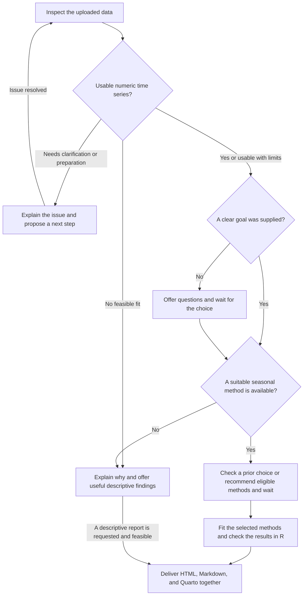

# Seasonal Decomposition Decision Tree

Use this guide to decide what to do after the user provides data. Use [checklist.md](checklist.md) to assess readiness, [methods.md](methods.md) to fit and verify the selected methods in R, and [report-spec.md](report-spec.md) to prepare the report. Reuse choices the user has already made.

## 1 Check the upload first

Inspect the file before asking the user what they want to do. Identify candidate time and numeric measurement columns or documented timing, groups, date range, observation interval, missing or duplicate observations, and possible seasonal coverage. Use the source notes and column contents to infer what the data represent. Label uncertain interpretations as tentative. A file can be readable yet unsuitable for seasonal decomposition.

| Finding | Next action |
| --- | --- |
| A usable series is clear | Summarize the series and relevant limitations briefly. Continue to the objective. |
| Several targets, groups, or time conventions are plausible | Ask one focused question when the choice would change the analysis. Offer grounded options, such as sales volume or revenue. |
| The time grid or values need preparation | Explain the specific issue and propose a treatment that fits the measurement. Obtain agreement for consequential changes that remain unresolved, then check the prepared series again. Keep the original data and flag changes. |
| File unreadable, no numeric time series, or no defensible timing | Explain what is missing and give a concrete next step, such as supplying dates or identifying a numeric measurement. Continue with useful inspection where possible. |
| Too little history, poor seasonal coverage, or no supported seasonal pattern | Explain what limits a seasonal fit. Offer a simpler descriptive answer if observations can still be interpreted, or suggest the additional history needed. |

Use the checklist to distinguish observations from filled positions. If seasonal evidence is weak, describe the uncertainty. A specifically requested eligible fit can be presented as exploratory when a plausible period exists and the user understands the limitation. If R or a required package is unavailable, explain which calculations remain pending and provide reproducible code. A mixed request can still proceed on its supported historical questions. Refer future forecasting and causal questions to the appropriate workflow.

## 2 Offer goals based on the dataset

First inspect and describe the data with summaries and exploratory plots as needed. This stage establishes what the series could help answer. Fit seasonal methods after the objective and method choice are settled.

If the user already gave a clear question, use it and skip the goal menu. Otherwise, say what the dataset appears to measure and offer a few questions that its time range and cadence could support. Use familiar units and the user's column meanings. Then wait for a choice or a custom request.

| If the data appear to show | Example questions to adapt |
| --- | --- |
| Daily sales or visits | Which weekdays are usually busiest? Is activity rising after accounting for the usual weekly pattern? |
| Hourly demand or traffic | What time of day is typically busiest? Does the pattern differ between weekdays and weekends? |
| Monthly sales, output, or other indicators | Which months are usually high or low? How much of a recent change is consistent with the usual seasonal pattern? |

Always include **General report** and **Type your own request**. For a general report, summarize the underlying direction, the clearest recurring highs and lows, their size where supported, and any unusual periods that stand out. Keep the number of plots small and explain each one fully. Use one suitable method by default, and up to three distinct methods in total only when each adds a clear and useful comparison. If the data support descriptive findings only, a general report can contain zero fitted methods. For a custom request, check what the data can answer before offering methods.

## 3 Recommend methods and wait for the choice

Use the selected objective, observed patterns, and the implementation requirements in [checklist.md](checklist.md) to screen all seven methods. Give the user a short list of eligible methods, with the recommendation first and a reason tied to this dataset and question. State tradeoffs that matter. If only one method is suitable, offer it and explain the constraint. Always include **Use the recommended method or comparison** and **Request a different method**. Use a choice interface when available, or a short numbered menu with free-text replies.

| Observed need | Candidate and reason to offer it |
| --- | --- |
| One stable pattern and roughly constant seasonal swings | **Classical additive decomposition.** It estimates repeating effects in the original measurement units. |
| One stable pattern and swings that grow in proportion to the level | **Classical multiplicative decomposition.** It gives proportional seasonal factors when the prepared values are strictly positive. |
| One seasonal period, with a possibly changing pattern or flexible trend | **STL.** It lets the seasonal shape evolve when useful and supports robust fitting for unusual values. |
| Several recurring patterns, such as daily and weekly | **MSTL.** It estimates each supported period separately on the same grid. |
| Monthly or quarterly seasonal adjustment with filtering and possible calendar effects | **X-11.** It offers filter-based trend and seasonal adjustment through X-13. |
| Seasonal adjustment for a supported calendar frequency with a suitable seasonal ARIMA model | **SEATS.** It extracts components from the fitted model through X-13. |
| Fractional periods, distinct calendar patterns, or explanatory variables relevant to the question | **STR.** It can represent flexible seasonal structures and additional predictors. |

For example, write “STL (recommended) because your monthly data show an annual pattern whose peaks appear to be changing.” Support each recommendation with the actual time grid, seasonal evidence, and implementation limits. If a requested method is unsuitable, explain the specific reason and ask whether to use an eligible alternative. Keep a general report within its three-method limit. If the user requests a broader comparison, confirm that as a focused objective.

Wait for a method choice before fitting unless the user already chose a suitable method, selected the recommended plan, or explicitly delegated method selection. A request for a general report establishes the objective. Follow it with a method recommendation and choice when selection has not been delegated. Once the plan is chosen, set routine parameters and explain consequential settings in the report. Obtain agreement for any unresolved preparation decision that would materially change the analysis.

## 4 Fit and verify

Fit the selected methods in R. Record the question, selected series, time convention, preparation, seasonal periods, chosen methods, actual settings, and reasons. Check reconstruction on the appropriate scale and span, inspect remaining seasonal patterns and unusual observations, and record warnings or limitations. For comparisons, use a common observation span and explain any differences in scales and effects.

Resolve recoverable failures within the selected plan. If a different method or consequential preparation is needed, explain why and return to that choice. If a seasonal fit remains unavailable, state which results could be computed and report descriptive findings where suitable.

## 5 Deliver the report

Generate and verify `report.html`, `report.md`, and `report.qmd` together for a completed analysis or descriptive report. Follow [report-spec.md](report-spec.md) for the shared report content, assets, and final checks. Give the main answer in the chat summary and link all three files.
